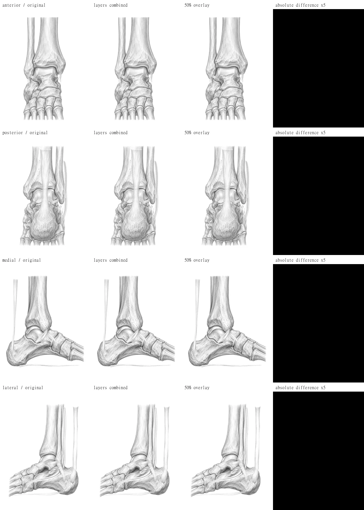

# 足関節4方向・膝の層追加（2026-11-07）

## 状態

足関節の4方向・2層・11部位と、膝4方向の2層候補を追加した。指定の座標検査とTypeScript検査は通過している。**膝は既存の1枚絵との合成一致が未達のため、今回全体を受け入れ合格・本番反映可能とはしていない。** コミットも、作業環境のGit管理領域への書き込み拒否により未実施。

## 納品ファイル

- `public/anatomy/ankle/{anterior,posterior,medial,lateral}.webp`
- 同じディレクトリの `<view>-bone.webp` と `<view>-ligament.webp`
- `src/lib/anatomy/zones/ankle.json`：前面4、後面6、内側5、外側8領域。既存の11 IDを全て含む。
- `src/lib/anatomy/index.ts`：膝と同じ形式のimportと登録配列への追加。
- `public/anatomy/knee/<view>-{bone,ligament}.webp` と `knee.json` の `layers`。膝の詳細は [膝の納品メモ](anatomy-knee-delivery.md#層追加2026-11-07今回の追記) に追記。
- [比較画像・検査数値](anatomy-review/metrics.json)、[再確認用スクリプト](../tools/review-anatomy-layers.mjs)、[生成指示全文](anatomy-review/generation-prompts.json)。

全て右側の関節、1000×1300px、グレースケール、文字・番号・引き出し線なし。boneは白背景・不透明、ligamentはWebPのalpha付き。筋・神経は描かず、許可されたbone＋ligamentの2層とした。アキレス腱・腓骨筋腱・足底腱膜はligament層に入っている。

足関節の容量（bytes。400,000 bytes以下で検査）：

| 向き | 1枚絵 | bone | ligament |
|---|---:|---:|---:|
| anterior | 336,490 | 133,906 | 15,040 |
| posterior | 303,140 | 131,040 | 108,678 |
| medial | 280,454 | 123,940 | 47,676 |
| lateral | 270,722 | 115,232 | 102,916 |

## 作り方

組み込みの `image_gen` を使用した。CLI/APIへの切替はしていない。既存の `public/joints` や実在する教科書・サイトの図を入力・模写していない。

1. 右足関節の骨・軟骨・関節裂隙だけの原画を4方向別に生成した。
2. Sharpで共通の縮小・余白調整を行い、1000×1300pxの白背景にした。骨画像をWebP品質90で保存した。
3. 各骨画像を位置の参照として、靭帯・腱だけを透明背景で生成した。生成された透明原画には余白の変化と輪郭外の白い粒があったため、そのまま採用せず、組織ごとに切り出し、骨の付着位置に合わせて配置・縮尺を調整した。外果前方のATFL、外果から踵骨へのCFL、後面のPTFL、内果の三角靭帯を分けた。
4. 輪郭外を透明に整え、ligamentをlossless WebPで保存した。最終boneとligamentを実際に合成し、その結果をlossless WebPの1枚絵にした。合成後に別々の画像調整はしていない。
5. 最終画像上で多角形とラベル位置を定め、右図・左反転図の重ね合わせで確認した。

生成指示の共通条件は、`Original medical textbook illustration of adult RIGHT ankle`、細いグレーの線と薄い陰影、1000:1300、文字なし、実在図を写さない、骨層に腱・靭帯を入れない、透明層に骨を入れない、である。向きごとに次の位置関係を明示した。プロンプトの全文と骨・透明層の区別は [generation-prompts.json](anatomy-review/generation-prompts.json) に保存。

| 向き | 指定した位置関係 |
|---|---|
| anterior | 腓骨・外果が画面左、脛骨・内果が画面右。 |
| posterior | 腓骨・外果が画面右、内果が画面左。後面の踵骨とアキレス腱、外側のPTFL・腓骨筋腱。 |
| medial | 前方が画面右、踵が画面左。内果から三角靭帯、後方にアキレス腱、足底に足底腱膜。 |
| lateral | 前方が画面左、踵が画面右。外果の前にATFL、下後方にCFL、外果後方を回る腓骨筋腱、距骨頚部下に足根洞。 |

骨・靭帯の基本的な接続関係は [NCBIの足関節の解説](https://www.ncbi.nlm.nih.gov/sites/books/NBK545158/) の検索結果の本文抜粋でも照合した。外部の図は使用していない。

## 確認

- `node tools/test-anatomy-zones.mjs`：問題なし。
- `npx tsc --noEmit`（Windowsでは `npx.cmd tsc --noEmit`）：終了コード0。
- 既存lint16件は依頼どおり今回の対象外。
- 実寸、WebP、400,000 bytes以下、boneの不透明・白い四隅、ligamentのalpha・透明な四隅、空でない描画を検査。
- 正本 `JointDetailMap.tsx` と11 ID・label・typeを照合。全領域の外接幅・高さは60px以上。
- SVGの描画順で他の領域に覆われない押せる点が全領域にあることを検査。境界から少なくとも2px離れた点を使い、左右反転しても同じIDが選ばれることを確認した。これは実機のタッチ操作試験ではない。
- **足関節は4方向すべて、最終WebPをデコードしたRGBで「bone＋ligament」と1枚絵が完全一致（最大差0、平均差0）。**

再確認コマンド：

```powershell
node tools/test-anatomy-zones.mjs
npx.cmd tsc --noEmit
node tools/review-anatomy-layers.mjs docs/anatomy-review
```

比較画像は左から「1枚絵／層の合成／両者を50%ずつ重ねた画像／絶対差分5倍」。黒い差分は一致を示す。検査画像内の見出し・IDは確認用で、`public/anatomy` の納品画像には入っていない。



[骨と透明層を別々に確認](anatomy-review/ankle-isolated.webp) · [右図・左反転図と選択領域](anatomy-review/ankle-zones.webp)

## 残課題・引き継ぎ

- 膝は切り出し輪郭・陰影に差が残る。既存の1枚絵を変更して合わせる処理はしていない。詳細・差分値は膝のメモを参照。**膝の合成一致は未達**。
- 院長・Claudeによる最終確認：実際のカルテ画面でのスマホ幅、方向切替、左右切替、層の表示・非表示、選択と解除。今回の確認は画像・データ・幾何検査までで、ログインしたカルテ画面での操作試験は行っていない。
- 生成図の骨形状・靭帯と腱の付着位置は臨床担当者の確認が必要。後面の深部靭帯は選択できるよう周囲組織を省略した説明図として描いている。
- `ank_sinus` の `type: "cartilage"` は正本の保存互換を保った値。足根洞そのものを軟骨組織に分類し直したものではない。
- 作業開始時のHEADは `a596b98`、ブランチ未所属（detached HEAD）。`git switch -c codex/knee-layers-ankle-anatomy` は `C:/Users/PC/yuuki-rehab/.git/refs/heads/...lock: Permission denied` で失敗した。Git管理領域がこの作業環境の書き込み可能範囲外のため、コミット・push・PRは未実施。mainへのコミットや本番反映は行っていない。ファイルの作成・検査結果は作業ツリーに残している。
